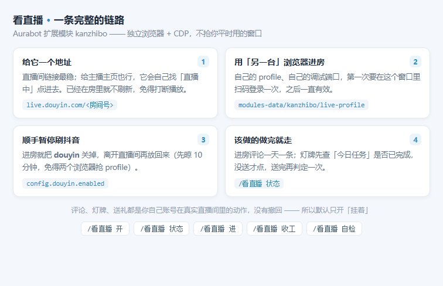
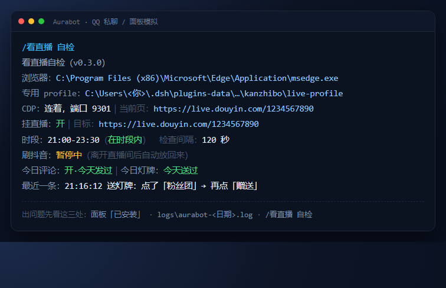

# kanzhibo · 看直播（Aurabot 扩展模块）

[](module/module.json)
[](AGENTS.md#5-运行时前提)
[](AGENTS.md#5-运行时前提)
[](AGENTS.md#1-装到哪里)
[](LICENSE)
[](https://github.com/h752603-source/dsh-aurabot-mod-kanzhibo/actions/workflows/check.yml)

给 [Aurabot（大肥鱼 QQ 插件）](https://github.com/accomplish07zrh-eng/dsh-aurabot-qq) 加的本事：
**用一台独立浏览器挂进抖音直播间**，进房、发一条定制评论、续粉丝团灯牌；挂着的时候自动暂停「刷抖音」。

- 模块 id：`kanzhibo` ｜ 版本：`0.3.0` ｜ 扩展接口：v1 ｜ 需要插件 ≥ 1.2.0
- 平台：Windows / macOS（装有 Edge 或 Chrome）
- 许可：MIT



## 装法一：手动复制（推荐）

```powershell
# Windows
$dst = "$env:USERPROFILE\.dsh\plugins-data\aurabot\modules\kanzhibo"
New-Item -ItemType Directory -Force "$dst\test" | Out-Null
Copy-Item .\module\* -Destination $dst -Recurse -Force
```

```bash
# macOS / Linux
dst=~/.dsh/plugins-data/aurabot/modules/kanzhibo
mkdir -p "$dst/test" && cp -R module/. "$dst"/
```

保存后 3~5 秒插件自动重载（不用重启）。日志里出现
`模块「看直播」（自己写的）已启动` 就是成了；出现 `加载失败：…` 就照报错改。

## 装法二：走「模块市场」

1. 设置环境变量指向本仓库的索引：
   `AURABOT_REGISTRY_URL=https://raw.githubusercontent.com/h752603-source/dsh-aurabot-mod-kanzhibo/main/registry/index.json`
2. 重启插件 → 面板「模块市场」刷新 → 安装 `kanzhibo`

`raw.githubusercontent.com` 打不开（国内常见）就换成 CDN 那份索引，`pack.mjs` 会自动生成 `registry/index-cdn.json`：

```
AURABOT_REGISTRY_URL=https://cdn.jsdelivr.net/gh/h752603-source/dsh-aurabot-mod-kanzhibo@main/registry/index-cdn.json
```

> 本仓库的 `assetsBase` 已经按 `h752603-source/dsh-aurabot-mod-kanzhibo` 写好；换了账号再跑一次 `node tools/pack.mjs --owner=<新用户名>`。

## 装完怎么验

```bash
node test/verify.mjs                 # 36 项逻辑检查，期望「0 失败」
set LIVE=1 && node test/verify.mjs   # 再加 3 项：真起 Edge / CDP 连上 / 收工能关（会弹一下窗口）
```

QQ 里发 `/看直播 自检`，会给一份体检单：浏览器路径、专用 profile、CDP 端口、时段在不在内、
刷抖音暂停状态、今日评论 / 灯牌完成没有、最近一条日志。面板「已安装」页看这一行有没有红色报错。



（图里是示意：房间号、路径都是占位，真机上是你自己的）

## 用起来长这样

```
/看直播            状态
/看直播 开         打开挂直播，立刻进一次房
/看直播 进         立刻进一次房
/看直播 关         关掉挂直播，刷抖音放回来
/看直播 收工       关掉浏览器
/看直播 自检       体检单
```

聊天里她自己也会用（模型按需调用）：`kanzhibo_enter`、`kanzhibo_status`、`kanzhibo_stop`、
`kanzhibo_gift`（只在你明说要送什么时）、`kanzhibo_say`（「在直播间说一句 XX」原话照发）。

设置项、判定规则、已知限制都写在 [`module/README.md`](module/README.md)。

## 仓库结构

```
.
├─ AGENTS.md                  ← 给 AI 代理的安装/验证说明书（不用读别的就能装）
├─ module/                    ← 模块本体：把它整个拷进 modules/kanzhibo/
│  ├─ index.mjs               ← 入口（全部逻辑都在这一个文件里）
│  ├─ module.json             ← 元数据（模块市场 / 校验用）
│  ├─ README.md               ← 模块文档：设置项、判定规则、会访问什么、变更
│  ├─ LICENSE                 ← MIT
│  └─ test/verify.mjs         ← 离线自检脚本（假 api，不发 QQ、不碰真配置）
├─ registry/
│  ├─ kanzhibo-0.3.1.zip      ← 可直接安装的包（zip 根目录 = 模块内容）
│  └─ index.json              ← 模块市场索引（schema 1，带 sha256）
├─ docs/
│  ├─ how.png                 ← 仓库首页那张链路图
│  ├─ selfcheck.png           ← 自检输出示意（房间号 / 路径都是占位）
│  └─ badges/*.svg            ← 本地静态徽章（不依赖 shields.io）
├─ tools/
│  ├─ pack.mjs                ← 一键重打包：算 sha256、写索引、回读校验
│  ├─ check.mjs               ← 发布前自洽检查（索引/版本/sha/自检），CI 也跑这个
│  ├─ badges.mjs              ← 重新生成 docs/badges/*.svg（改了版本号就跑一次）
│  └─ publish.mjs             ← 一条命令发到 GitHub（不需要装 git，走 Git Data API）
└─ .github/workflows/check.yml ← 每次 push 自动检查索引和包对不对得上
```

## 自己发版怎么打

```bash
node tools/pack.mjs --owner=<GitHub用户名>            # 仓库名默认取文件夹名
node tools/check.mjs                                  # 发之前先自己查一遍
node tools/publish.mjs --token=ghp_xxx                # 建仓库 + 一次提交推上去
```

`publish.mjs` 会先用真账号重打包（把 `USER/REPO` 换成真地址），仓库不存在就建一个 public 的，
然后用 blob → tree → commit → ref 一次提交推完，最后打印该填给插件的 `AURABOT_REGISTRY_URL`。
没装 git 也能用，只认一个 token（classic 勾 `repo`，或 fine-grained 给 Contents + Administration 读写）。

## 它靠什么判断（不想被改版坑就先看）

| 判断 | 依据 |
|---|---|
| 在不在直播间 | URL 以 `https://live.douyin.com/` 开头 |
| 页面加载完了 | 有可见的 `textarea` / `contenteditable`，或标题含「直播 / 直播间」 |
| 灯牌今天送过了 | 今日任务里「灯牌」+「已完成 / 已送出 / 已领取 / 已点亮」 |
| 评论发出去了 | 点完发送回读输入框，还含有前 3 个字就算失败 |
| 礼物送出去了 | 抖币余额变小 /「赠送成功」提示 / 飘屏出现「礼物名 × N」 |
| 该停了 | 页面出现「充值 / 抖币不足 / 余额不足 / 去充值」 |

## 注意

- 抖音改版会换 DOM，找评论框 / 今日任务 / 粉丝团入口都可能失效；报错会进面板「日志」页（按模块 id 分类）。
- 评论、灯牌、送礼都是**用你自己的账号**在真实直播间里的真实动作，没有撤回。
- 不处理验证码：页面弹验证码时只会失败并把原因说出来。
- 一台机器同一时间只挂一个直播间（一个 profile 一个窗口）。

## 许可

MIT。见 [`LICENSE`](LICENSE)。
